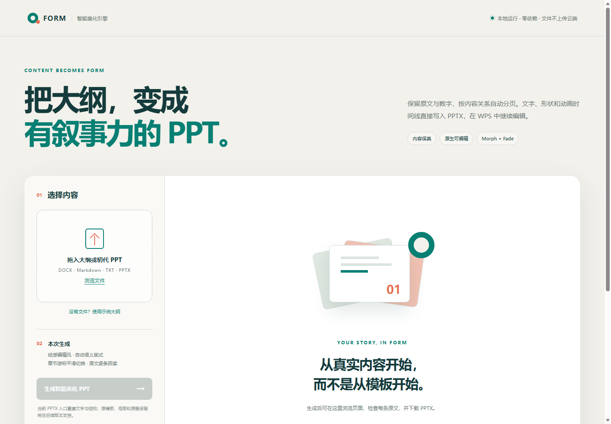

# SmartPPT

把 Word、Markdown、TXT 大纲或文字型 PPTX 重建为**原生可编辑**的演示文稿，并在在线网页中完成上传、预览、原文对账、耗时查看和下载。访问者不需要安装 Python、Node.js，也不需要启动本地生成服务。

当前版本是一个可运行的早期原型：重点验证内容保真、自动分页、浏览器内原生 OOXML 写入、Morph 转场与 WPS 兼容降级，不等同于成熟的自动设计工具。



## 特性

- 支持 `.docx`、`.md`、`.markdown`、`.txt`、`.pptx`，单文件最大 25 MB。
- 保存正文来源、标题层级和数字，生成后逐条回读；遗漏会阻止交付。
- 识别 Markdown 多级标题、Setext 标题、嵌套列表与换行段落；TXT 区分章节编号和连续要点，DOCX 支持 Title、Subtitle、大纲级别、嵌套列表与表格文字。
- 按 PPT 实际播放顺序读取，支持组合坐标、默认字号、表格与 SmartArt 文本，并单独读取对应页演讲者备注。
- 来源目录的全部有效条目与后续章节对应时，合并为一份目录并保留原标题与计数；无法匹配的自定义目录继续保留为正文。跨页页眉页脚、同页卡片序号和窄规则英文品牌／导航标签会归入装饰，英文来源等文本不按该品牌规则过滤。
- 提供纸感编辑、深色发布会、清透商务三套主题，按陈述、对比、流程、数据、图片与公式逐页适配布局；长目录自动续页。
- 输出原生文字、形状和 PNG/JPEG 图片，不用整页截图冒充可编辑 PPT；Markdown 可随附图片素材。
- 支持 Markdown 与 DOCX 数学内容，以 Cambria Math 可编辑文本呈现；当前不生成原生公式对象。
- 写入 Morph by Object，并提供非黑场 Fade 降级与错峰入场。
- 在线网页在当前浏览器标签页内完成解析、生成与回读，提供页面预览、内容对账、真实分阶段耗时和 Blob 下载；源文件不上传到服务器。
- Python、Node.js 与浏览器引擎均只使用标准能力，无需 `pip install` 或 `npm install`；本地 Python/Node 服务仅保留为可选开发兼容入口。

## 快速开始

### 在线使用

将 `dist/` 发布到静态网站托管后，访问者直接打开公开链接即可使用。文件只在当前浏览器标签页内处理，静态服务器不提供生成 API，也不保存上传内容。浏览器需支持 ES modules、DOMParser 和 `DecompressionStream('deflate-raw')`，建议使用最新版 Chrome、Edge 或 Safari。

### 构建在线站点

开发构建需要已有 Node.js 18+，但访问者不需要：

```bash
node scripts/build-online.cjs
```

构建结果位于 `dist/`，其中包含完整浏览器引擎、PPTX 基础包和示例大纲，无第三方运行库。

### 可选本地开发

需要本地调试时，使用已有 Python 3.10+ 与 Node.js 18+：

```bash
node src/web/server.js
```

打开 <http://127.0.0.1:4173>。当前页面仍在浏览器内生成，旧 `/api` 仅用于兼容回归。可通过 `HOST`、`PORT`、`PYTHON`、`RUNTIME_DIR` 调整旧本地 API；这些环境变量不是在线版访问者的使用前提。

### 命令行生成

```bash
python src/smart_ppt.py plan examples/outline.md --out output/demo
python src/smart_ppt.py render output/demo/job.json --output output/demo.pptx
python src/smart_ppt.py audit output/demo/job.json output/demo.pptx
```

Windows 若没有 `python` 命令，可将上述命令替换为 `py -3`。

生成目录包含：

- `content.json`：带来源的正文与装饰元素；
- `job.json` 和 `pages/`：页面计划与原生页面结构；
- `timings.json`、`render-timings.json`：真实分阶段耗时；
- `fidelity-audit.json`：原文回读结果。

## 测试

```bash
python -m unittest discover -s tests -p "test_*.py"
node --test tests/web.test.cjs
```

测试覆盖混合编号大纲、DOCX 标题与表格、PPTX 实际页序、默认字号、SmartArt、长目录边界、来源目录匹配合并、真实 PPT 回转不膨胀、自定义目录保留、卡片序号与品牌装饰识别、OOXML 结构和保真审计，以及真实 HTTP 兼容回归与在线静态构建完整性。网页测试会启动独立服务并使用临时任务目录，不需要第三方测试框架。

## 仓库结构

```text
SmartPPT/
├── src/
│   ├── assets/base.pptx    # 最小母版与主题包壳
│   ├── smart_ppt.py        # 解析、规划、渲染、动画和审计
│   └── web/                # 在线网页、浏览器引擎与可选本地 API
├── scripts/                # 静态站点构建
├── dist/                   # 构建后的可发布网站（被 Git 忽略）
├── docs/                   # 使用说明与界面截图
├── examples/
│   ├── outline.md          # 可直接上传的示例大纲
│   └── output/             # 已生成的示例 PPTX
├── tests/                  # Python 与 Node.js 测试
├── LICENSE
├── requirements.txt        # 明确说明零第三方 Python 依赖
└── package.json            # 启动与测试命令，无 npm 依赖
```

## 当前边界

- 已支持显式备注语法和 PPT 演讲者备注，但自由格式正文语义与跨页叙事识别仍可能误判。
- 三套主题与内容适配布局不等于自由文本驱动的完整定制设计系统。
- PPTX 入口当前重建文字与结构，**不保留原模板、母版、原图、原始动画或对象身份**；表格与 SmartArt 目前提取文字后重排，不保留原生表格或图形结构，复杂页面仍需人工复核。
- 网页图片素材目前用于 Markdown 相对文件名引用；不会自动下载外部图片。DOCX/PPTX 内嵌原图尚未进入重建链路。
- 公式以可编辑数学文本保留，不排版 LaTeX，也不生成原生 Office 公式对象。
- 已加入文本宽度估算和原生自动缩放，但不能替代真实渲染后的溢出、遮挡检查。
- 在线版依赖现代浏览器的 ES modules、DOMParser 和 Office ZIP 解压能力；旧浏览器会明确提示，不会静默退回本地服务。
- 生成任务与结果保存在当前页面内存中，刷新页面会清除未下载结果；文件处理不涉及服务器队列、对象存储或云端任务数据库。
- 网页预览不代表 WPS 动画验收。最终文件仍应在目标 WPS 版本中打开并播放检查。

详细操作、字体与素材规则、耗时口径和验证范围见 [使用说明](docs/USER_GUIDE.md)。

## 架构参考

已核对 [PPT Master](https://github.com/hugohe3/ppt-master)、[Huashu Design](https://github.com/alchaincyf/huashu-design)、[baoyu-slide-deck](https://github.com/JimLiu/baoyu-skills/tree/main/skills/baoyu-slide-deck)、[MiniMax pptx-generator](https://github.com/MiniMax-AI/skills/tree/main/skills/pptx-generator) 与 [Codex PPT Skill](https://github.com/ningzimu/codex-ppt-skill)：它们最终都依赖本地 Python、Node/Bun 或整页图片装配，并非可直接分享的公共在线生成服务。本项目借鉴来源锚点、声明式页面任务、设计令牌、顺序装配与审计，但改用浏览器内原生可编辑 OOXML，不引入其本地运行时或整页图片方案。

## License

[MIT](LICENSE)
